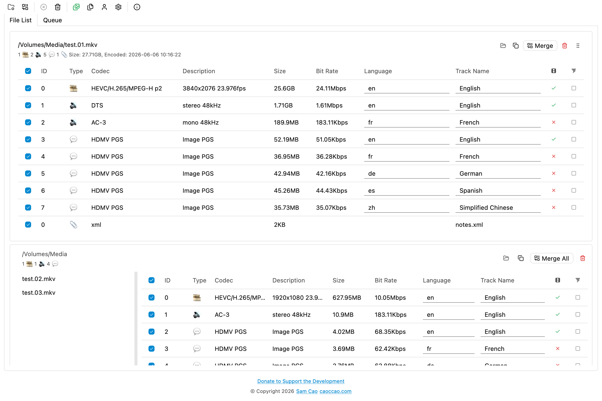

# BatchMkvMerge

  

BatchMkvMerge is a desktop app that drives [mkvmerge](https://mkvtoolnix.download/doc/mkvmerge.html) from [MKVToolNix](https://mkvtoolnix.download/) across many files at once, so you can merge tracks, chapters, and attachments out of a whole batch without hand-writing commands. It is a native Rust application built on [gpui-kit](https://crates.io/crates/gpui-kit).

## Features

* Cross-platform: Windows, Linux, macOS (Intel and Apple silicon)
* Drag and drop media files or folders: every format mkvmerge reads, recognised by a built-in parser
* One card per output file: with *Group by file name*, a video and the files named after it (audio, subtitles) merge into one output, and cards can be dragged onto each other
* Group cards: files with the same track layout, such as the episodes of a season, are edited together
* Per card: track selection and order, languages, track names, default and forced flags
* Profiles pick tracks by type and language and fill in languages, track names and flags automatically
* Per-drive parallel merge queue with a live progress bar, elapsed time and ETA; cancel from the card or the queue, resume from the queue
* Optional system and topmost notifications when the queue finishes, and the progress on the taskbar, Dock or launcher icon
* 9 UI languages, 20 colour themes, light, dark and auto modes
* Integrate with [BetterMediaInfo](https://github.com/caoccao/BetterMediaInfo)

## Installation

* Make sure you have [MKVToolNix](https://mkvtoolnix.download/) installed.
* Download the installer for your system from [Releases](https://github.com/caoccao/BatchMkvMerge/releases) or [Actions](https://github.com/caoccao/BatchMkvMerge/actions):
  * Windows: the NSIS `-setup.exe` (installs for the current user) or an `.msi` (installs for all users; one per language).
  * macOS: the `.dmg` for Intel or Apple silicon; drag BatchMkvMerge into Applications.
  * Linux: the `.deb` (Debian, Ubuntu), the `.rpm` (Fedora and other rpm-based distributions) or the `.AppImage`.
* Run the installer, then launch the app from the Start Menu (Windows), the Applications folder (macOS) or the application menu (Linux).
* The installers are not signed. If macOS blocks the first start, allow it in System Settings > Privacy & Security; Windows SmartScreen may ask before the installer runs.

System requirements:

* Windows 10 1903 or later with a DirectX 11 graphics driver.
* macOS 12 Monterey or later.
* Linux with an X11 or Wayland session, a Vulkan driver (Mesa is enough) and glibc 2.35 or later (Ubuntu 22.04, Debian 12, Fedora 36 or newer). File dialogs use the desktop's XDG portal.

### Upgrading from 0.1.0

Install 1.0.0 over 0.1.0 with the same kind of installer (NSIS over NSIS, MSI over MSI, the package over the package, the app over the app in Applications): it replaces 0.1.0 in place, and your settings stay where they are and load unchanged. 1.0.0 no longer needs WebView2 on Windows or WebKitGTK on Linux. Systems below the requirements above stay on 0.1.0. See the [release notes](docs/release_notes.md) for what changed.

## Documentation

* [Development](docs/development.md)
* [Screenshots](docs/screenshots.md)
* [Release Notes](docs/release_notes.md)

## License

[APACHE LICENSE, VERSION 2.0](LICENSE)
